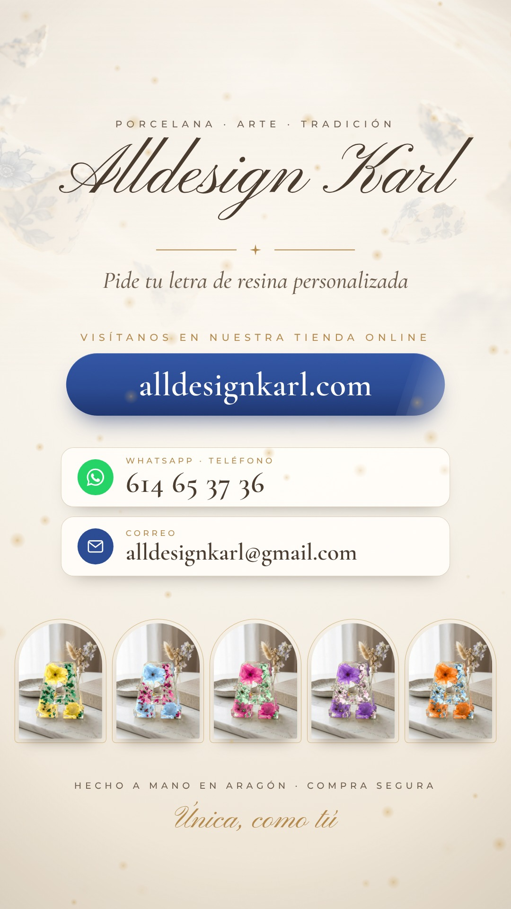

# Alldesign Karl · Anuncio de la tienda online

Anuncio vertical de **19,8 s** (1080×1920, 30 fps, H.264 + AAC) para Reels, TikTok, Stories y WhatsApp.
Protagonistas: la **tienda online [alldesignkarl.com](https://alldesignkarl.com)** y la **Letra de resina**.



## Archivos finales

| Archivo | Uso |
|---|---|
| [`video/AlldesignKarl_Tienda_Online_1080x1920.mp4`](video/AlldesignKarl_Tienda_Online_1080x1920.mp4) | Máxima calidad (Instagram, TikTok, Facebook, YouTube Shorts, web) |
| [`video/AlldesignKarl_Tienda_Online_WhatsApp_720p.mp4`](video/AlldesignKarl_Tienda_Online_WhatsApp_720p.mp4) | Versión ligera para enviar por WhatsApp |
| [`video/portada.jpg`](video/portada.jpg) | Portada / miniatura |
| [`audio/banda_sonora.flac`](audio/banda_sonora.flac) | Música sola (original, -14 LUFS) |

## Guion

| Tiempo | Imagen | Rótulos |
|---|---|---|
| 0,0–2,2 s | La portada **real** de la tienda a pantalla completa, con su propia animación de entrada (el logo se escribe como tinta). | — |
| 2,2–3,3 s | La cámara se aleja y descubre que es la web en un móvil, que gira en 3D. | *YA DISPONIBLE · Nuestra tienda online* · `alldesignkarl.com` (se escribe) |
| 3,3–5,7 s | Se baja por la tienda: *Nuestras colecciones* → la Letra de resina. | *LA PIEZA ESTRELLA · Letra de resina con flores naturales* |
| 5,7–11,4 s | Se pulsa la letra, se abre su ficha y se cambian los colores (flores + ramitas): amarillo → amarillo y azul → azul → azul y rosa → rosa → rosa y morado. La foto cambia al momento con cada toque. Se escribe la inicial "A" y se pulsa *Añadir a la cesta*. | *PERSONALÍZALA · Elige tus colores y mira cómo queda* |
| 11,4–13,2 s | Desde el dedo se abre un círculo: montaje de combinaciones de la letra y contador hasta 100. | *10 COLORES · ELIGE DOS · 100 combinaciones* |
| 13,2–14,9 s | Cae la noche y la letra se enciende (fragmento del vídeo [Letra A de resina iluminada](https://github.com/AlldesignKarl/Letra-A-resina-Ilumninada)). | *Y cuando cae la noche… se ilumina · LUCES LED · FLORES NATURALES* |
| 14,9–19,8 s | Cierre: logo, web, WhatsApp, correo y cinco letras de colores. | *Pide tu letra de resina personalizada* · **alldesignkarl.com** · **614 65 37 36** · **alldesignkarl@gmail.com** · *Hecho a mano en Aragón · Compra segura* · *Única, como tú* |

Música original sintetizada para el anuncio (109 BPM, sin derechos de terceros): cada toque de color
suena como una nota de una melodía que sube, el encendido de la letra lleva su golpe y destellos, y la
mezcla está a -14 LUFS con el pico real por debajo de -2 dB (estándar de Instagram, TikTok y YouTube).

## Cómo se ha hecho

- **La tienda es la de verdad.** `tienda/index.html` es una copia del código de la web
  ([Alldesignakarl](https://github.com/AlldesignKarl/Alldesignakarl), commit `a041fab`). Se abre en un
  Chromium en local con tamaño de móvil y `tools/store_sim.cjs` responde a sus llamadas a Wix con un
  catálogo de prueba hecho con las fotos reales de las piezas (`assets/img`) y las vistas previas de
  color reales (`assets/img/colores`). No se conecta a nada externo.
- **Grabación perfecta.** `tools/capture_store.cjs` graba la web fotograma a fotograma con un reloj
  virtual: pausa todas sus animaciones CSS y las coloca en el instante exacto de cada fotograma.
  El scroll se graba a 120 fps para que el desenfoque de movimiento sea suave.
- **Composición.** `src/promo.html` monta el anuncio (móvil en 3D, rótulos, montaje, partículas, cierre)
  y todo depende solo del tiempo, así que cada render sale idéntico. `tools/render_promo.cjs` captura cada
  fotograma con varias submuestras (obturador de 180°) y `tools/build.py` las promedia, añade un tramado
  fino contra el banding y codifica.
- Tipografías de la marca: Pinyon Script y Cormorant Garamond (las de la web) y Montserrat, todas con
  licencia OFL (`assets/fonts`).

## Notas

- **Precios ocultos.** Los precios de las piezas están en Wix y no en el repositorio de la tienda, así
  que en el vídeo no se muestran (no se inventan). Si se quieren mostrar, basta con añadirlos al catálogo
  de `tools/store_sim.cjs` y quitar la línea que los oculta en `tools/capture_store.cjs`.
- **Nombres de las piezas.** En la grabación la pieza se llama "Letra de resina" (como en el historial de
  la tienda). Si en Wix tiene otro nombre, se cambia en `tools/store_sim.cjs`.
- La web `alldesignkarl.com` no era accesible desde el entorno donde se ha hecho el vídeo; por eso se
  graba la copia de su código, que es exactamente la misma página.

## Regenerarlo

Requisitos: Node 18+ con Playwright (Chromium), Python 3 con numpy, Pillow y scipy, y ffmpeg.

```bash
python3 tools/build.py            # reutiliza la grabación de la tienda si ya existe
python3 tools/build.py --store    # vuelve a grabar la tienda
# fotogramas sueltos para revisar sin renderizar todo:
NODE_PATH=$(npm root -g) node tools/render_promo.cjs --stills 3,8,12,14,17 --out build/stills
```

Para verlo animado en el navegador: sirve la carpeta del repositorio y abre `src/promo.html?play`
(después de haber grabado la tienda, porque usa `build/store`).
